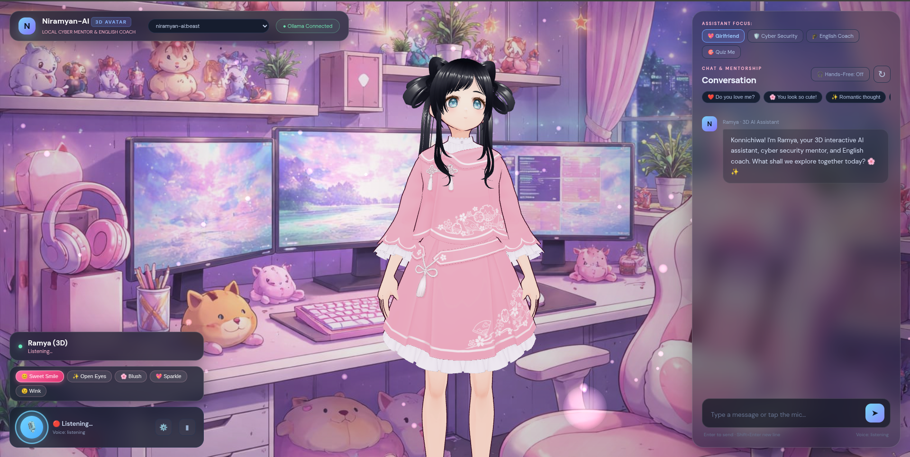
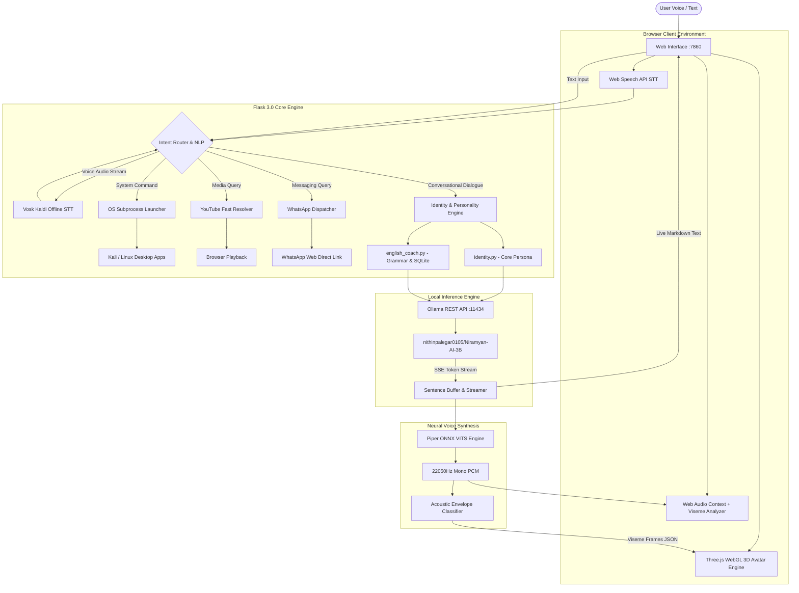

# Niramyan-AI: Privacy-First Local AI Assistant & 3D Interactive Anime Companion

<p align="center">
  
</p>

<p align="center">
  <b>A 100% offline, privacy-first personal AI companion, cybersecurity mentor, and English coach featuring an interactive 3D WebGL anime avatar with real-time lip-sync, powered by Ollama, Piper Neural TTS, and Vosk.</b>
</p>

<p align="center">
  <a href="https://github.com/nithin644/Niramyan-AI"></a>
  <a href="https://ollama.com/nithinpalegar0105/Niramyan-AI-3B"></a>
  <a href="https://github.com/rhasspy/piper"></a>
  <a href="https://threejs.org/"></a>
  <a href="https://flask.palletsprojects.com/"></a>
  <a href="https://www.kali.org/"></a>
  <a href="LICENSE"></a>
</p>

---

## 🎥 Demo Video

<p align="center">
  <a href="https://github.com/nithin644/Niramyan-AI#demo-video">
    
  </a>
</p>

<p align="center">
  <a href="https://github.com/nithin644/Niramyan-AI/releases">
    
  </a>
</p>

> 💡 **Demo Walkthrough**: Experience zero-latency voice interaction, English grammar mentoring, automated Kali Linux tool launching, instant YouTube music playback, and 3D WebGL anime avatar lip-sync in action.  
> *(To link your uploaded walkthrough video, add your MP4 to the GitHub release or place it in `docs/demo.mp4`)*.

---

## 📋 Table of Contents

- [🌟 Overview](#-overview)
- [✨ Key Features](#-key-features)
  - [1. 3D WebGL Anime Avatar & Acoustic Viseme Lip-Sync](#1-3d-webgl-anime-avatar--acoustic-viseme-lip-sync)
  - [2. Local Intelligence via Custom Ollama Model](#2-local-intelligence-via-custom-ollama-model)
  - [3. Dual-Engine Neural Speech (TTS) & Offline Recognition (STT)](#3-dual-engine-neural-speech-tts--offline-recognition-stt)
  - [4. Dedicated Multi-Modal AI Personalities](#4-dedicated-multi-modal-ai-personalities)
  - [5. English Learning Coach with SQLite Grammar Analytics](#5-english-learning-coach-with-sqlite-grammar-analytics)
  - [6. Cybersecurity Mentor & Kali Linux Automation](#6-cybersecurity-mentor--kali-linux-automation)
  - [7. Desktop Tool Launcher, YouTube & WhatsApp Dispatcher](#7-desktop-tool-launcher-youtube--whatsapp-dispatcher)
- [🏗️ System Architecture](#-system-architecture)
- [🧠 Model Specifications](#-model-specifications)
- [💻 Hardware & Software Requirements](#-hardware--software-requirements)
- [🚀 Quickstart & Installation](#-quickstart--installation)
- [⚙️ Configuration](#-configuration)
- [📖 Voice Commands & Usage Guide](#-voice-commands--usage-guide)
- [📸 Visual Interface Gallery](#-visual-interface-gallery)
- [🔒 Privacy & Offline Guarantees](#-privacy--offline-guarantees)
- [👨‍💻 Developer Profile: Nithin Palegar](#-developer-profile-nithin-palegar)
- [📄 License & Open-Source Credits](#-license--open-source-credits)

---

## 🌟 Overview

**Niramyan-AI** is a production-grade, self-hosted, offline AI companion created by **Nithin Palegar**. Built from the ground up for low latency, zero external data leakage, and high conversational immersion, it brings together local large language models, neural speech synthesis, offline acoustic recognition, and an interactive 3D anime character rendered in real time.

Unlike commercial assistants that send user telemetry, keystrokes, and audio recordings to cloud APIs, Niramyan-AI operates **100% locally** on your machine:
- **Zero Cloud Footprint**: All audio processing, LLM generation, and memory storage stay on local disks and RAM.
- **Sub-Second Conversational Response**: Token streaming via Server-Sent Events (SSE) paired with sentence-level audio buffering delivers voice output in under 300ms on modern multi-core CPUs.
- **Multimodal 3D VRM Rendering**: Powered by Three.js and `@pixiv/three-vrm`, featuring natural gaze tracking, cute relaxed gestures, and real-time phonetic viseme matching.

---

## ✨ Key Features

### 1. 3D WebGL Anime Avatar & Acoustic Viseme Lip-Sync
- **Three.js & VRM 1.0 Runtime**: Real-time rendering with MToon cel-shading, anisotropic hair textures, and falling Sakura petal particle physics.
- **Phonetic Lip-Sync & Viseme Alignment**: Dynamically aligns speech audio with VRM vowel visemes (`aa`, `ih`, `ou`, `ee`, `oh`) via Web Audio API frequency analysis and phonetic word tokenizers.
- **Natural Gaze & Expressive Reactions**: The avatar tracks the user's cursor with soft head tilts, blinks naturally at randomized intervals ($2.4\text{s} - 5.0\text{s}$), and plays motion-captured `.vrma` animations (greetings, peace signs, model poses, playful winks).
- **Petite Smile & Open Gaze Engine**: Custom-tuned blendshapes enforce sweet smiles (`Fcl_MTH_Small`, `Fcl_MTH_Up`) while keeping her expressive jewel eyes wide open and alert (`Fcl_EYE_Spread`).

### 2. Local Intelligence via Custom Ollama Model
- Uses `nithinpalegar0105/Niramyan-AI-3B` hosted on local Ollama (`http://127.0.0.1:11434`).
- Streamlined runtime configuration (`num_ctx: 1024`, `temperature: 0.7`, `num_predict: 45`, `top_k: 40`, `top_p: 0.9`) tuned for rapid real-time conversational cadence.
- Immutably binds core identity as **Ramya**, personal AI companion to developer **Nithin Palegar**, ensuring consistent persona across all modes.

### 3. Dual-Engine Neural Speech (TTS) & Offline Recognition (STT)
- **Piper Neural TTS**: High-fidelity, local ONNX VITS feminine voice (`en_US-hfc_female-medium`) running at Real-Time Factor (RTF) $< 0.08$ on standard CPUs.
- **Web Speech API Fallback**: Built-in zero-setup browser synthesis and interim voice recognition.
- **Vosk Offline STT**: Bundled Kaldi acoustic engine (`vosk-model-small-en-us-0.15`) for hands-free ambient voice recognition without an internet connection.
- **Custom Phonetic Lexicon**: Resolves technical terms (`Wireshark`, `Metasploit`, `Niramyan`, `OWASP`, `Kali`, `SQLi`) into smooth phonetic English.

### 4. Dedicated Multi-Modal AI Personalities
Switch between 6 specialized AI roles via voice commands or glassmorphic UI chips:

| Mode | Voice Command | Role Description | Key Capabilities |
| :--- | :--- | :--- | :--- |
| **Girlfriend** (`girlfriend`) | *"Switch to Ramya mode"* | Warm, affectionate, expressive companion | Empathetic daily dialogue, cute banter, playful animations & winks |
| **English Coach** (`english`) | *"Switch to English coach"* | Patient, structured language mentor | Real-time grammar fixes, CEFR conversational roleplays, mistake logging |
| **Cyber Security** (`cyber`) | *"Switch to cyber security mode"* | Technical Kali Linux & infosec guide | Bug bounty tips, network forensics, OWASP Top 10, penetration testing |
| **Quiz Me** (`quiz`) | *"Switch to quiz mode"* | Rapid-fire interactive examiner | Tests knowledge in networking, Linux commands, grammar, and security |
| **Coding Assistant** (`coding`) | *"Switch to coding mode"* | Senior software engineer | Python scripts, Bash automation, algorithm debugging, code optimization |
| **Research Mode** (`research`) | *"Switch to research mode"* | Structured technical investigator | Technical summaries, vulnerability analysis, documentation synthesis |

### 5. English Learning Coach with SQLite Grammar Analytics
- **Live Error Interceptor**: Detects tense disagreements (*"I go to college tomorrow"* $\to$ *"I will go / am going"*), subject-verb agreements, and awkward phrasing.
- **Educational Follow-Up**: Provides gentle, constructive feedback and immediately asks an engaging question to keep the conversation flowing.
- **Persistent Progress Tracking**: Tracks practiced sentences, mastery metrics, and error histories in local SQLite (`english_progress.db`).
- **9 Structured Scenarios**: Job Interview, Restaurant, Travel, College Life, Shopping, Friendly Chat, Self Introduction, Workplace, and Free Speech.

### 6. Cybersecurity Mentor & Kali Linux Automation
- Practical mentorship for ethical hackers and security researchers.
- Guidance on command construction for `nmap`, `wireshark`, `burpsuite`, `sqlmap`, and `hydra`.
- Strict ethical guardrails preventing malicious or weaponized exploit creation against unauthorized systems.

### 7. Desktop Tool Launcher, YouTube & WhatsApp Dispatcher
- **System Tool Execution**: Launches Linux applications (`qterminal`, `gnome-terminal`, `wireshark`, `burpsuite`, `code`, `firefox`, `thunar`) on voice request.
- **Instant YouTube Music Player**: Intercepts *"open youtube and play [song]"*, extracts the top video ID via regex HTTP resolution, and opens browser playback.
- **Automated WhatsApp Web Dispatcher**: Matches spoken contact names against `contacts.json`, normalizes numbers, and opens pre-filled direct WhatsApp Web chats.

---

## 🏗️ System Architecture



---

## 🧠 Model Specifications

### Primary Model: `nithinpalegar0105/Niramyan-AI-3B`

The default model is optimized for sub-second conversational latency, high instruction fidelity, and low memory utilization on standard laptops and desktops:

```yaml
Model Identifier: nithinpalegar0105/Niramyan-AI-3B
Base Architecture: Qwen2 (3.09 Billion Parameters)
Quantization: Q4_K_M (4-bit Medium Quantization)
Context Window: 32,768 tokens (Metadata) / 1,024 tokens (Runtime optimized)
Disk Footprint: ~1.9 GB
RAM Consumption: ~2.4 GB - 3.2 GB
Target Hardware: Modern 4-Core+ x86_64 CPU (AVX2) or Apple Silicon / CUDA
Inference Speed: 25 - 45 tokens/second on standard CPU
```

To test and run the model directly in your terminal:
```bash
ollama pull nithinpalegar0105/Niramyan-AI-3B
ollama run nithinpalegar0105/Niramyan-AI-3B
```

---

## 💻 Hardware & Software Requirements

| Component | Minimum Specification | Recommended Specification |
| :--- | :--- | :--- |
| **Operating System** | Linux (Kali Linux, Ubuntu 20.04+, Debian 12+) or macOS | Kali Linux Rolling (x86_64) / Ubuntu 22.04 LTS |
| **Processor (CPU)** | x86_64 with AVX2 support (Intel 8th Gen+ / AMD Ryzen 2000+) | AMD Ryzen 5 / 7 or Intel Core i7 / i9 (6+ Cores) |
| **System Memory** | 8 GB RAM | 16 GB DDR4/DDR5 RAM |
| **Graphics (GPU)** | Integrated Graphics (Intel UHD / AMD Radeon) | NVIDIA GTX 1650+ (4GB VRAM) or Apple M-Series |
| **Disk Space** | 8 GB available SSD storage | 15 GB NVMe SSD |
| **Audio** | Standard microphone and speakers / headphones | Noise-cancelling headset microphone |

---

## 🚀 Quickstart & Installation

Follow these steps to set up and run Niramyan-AI on your Linux machine:

### 1. Install System Prerequisites
```bash
sudo apt update
sudo apt install -y git curl ffmpeg python3 python3-venv python3-pip
```

### 2. Install and Start Ollama
```bash
# Install Ollama official binary
curl -fsSL https://ollama.ai/install.sh | sh

# Start the Ollama background daemon
ollama serve > /dev/null 2>&1 &
```

### 3. Pull the Niramyan-AI Model
```bash
ollama pull nithinpalegar0105/Niramyan-AI-3B
```

### 4. Clone the Repository
```bash
git clone https://github.com/nithin644/Niramyan-AI.git
cd Niramyan-AI
```

### 5. Install Piper Neural TTS
```bash
chmod +x install_piper.sh
./install_piper.sh
```
*This downloads the standalone `piper` binary and the neural voice `en_US-hfc_female-medium` into `./piper/` and `./voices/`.*

### 6. Set Up Python Environment & Run
```bash
# Create virtual environment
python3 -m venv .venv
source .venv/bin/activate

# Install Python requirements
pip install -r requirements.txt

# Launch application
python3 app.py
```
*Or execute the automated runner script:*
```bash
chmod +x run.sh
./run.sh
```

### 7. Access the Web Interface
Open your browser and navigate to:
- **3D Interactive Experience**: [`http://127.0.0.1:7860/3d`](http://127.0.0.1:7860/3d)
- **Classic 2D Interface**: [`http://127.0.0.1:7860/2d`](http://127.0.0.1:7860/2d)

*(Google Chrome or Chromium is recommended for full Web Audio API and Speech Recognition support).*

---

## ⚙️ Configuration

### Voice and Avatar Tunables (`voice_config.json`)
Fine-tune synthesis rate, acoustic viseme framing rate, and pitch:

```json
{
  "active_engine": "piper",
  "piper": {
    "enabled": true,
    "binary_path": "piper/piper",
    "selected_voice": "en_US-hfc_female-medium",
    "length_scale": 1.05,
    "noise_scale": 0.667,
    "sentence_silence": 0.20
  },
  "web_speech": {
    "pitch": 1.25,
    "rate": 0.96,
    "volume": 1.0
  },
  "animation": {
    "viseme_fps": 50,
    "blink_min_interval_sec": 2.5,
    "blink_max_interval_sec": 5.0
  }
}
```

### Contacts for WhatsApp Messaging (`contacts.json`)
Store names and phone numbers for instant message dispatching:

```json
{
  "nithin": "+919876543210",
  "alex": "+14155552671",
  "my world": "+919876543210"
}
```

---

## 📖 Voice Commands & Usage Guide

| Goal | Example Spoken Voice Prompt | Assistant Action |
| :--- | :--- | :--- |
| **Identity Check** | *"Who created you?"* | States her name is Ramya, created by Nithin Palegar, referencing his infosec background. |
| **English Practice** | *"I go to college tomorrow"* | Gently corrects grammar: *"Say 'I will go to college tomorrow'..."* |
| **Cybersecurity** | *"Explain SQL injection prevention"* | Details parameterized queries, input validation, and defensive secure coding. |
| **YouTube Music** | *"Open YouTube and play believer song"* | Resolves video URL and launches browser playback automatically. |
| **WhatsApp Message** | *"Open WhatsApp and send Hi to Alex"* | Finds contact, formats international number, and opens WhatsApp Web chat. |
| **App Launch** | *"Open Wireshark"* / *"Launch terminal"* | Executes local binary on the desktop and confirms completion. |
| **Cute Interactions** | *"Do you love me?"* / *"You look so cute!"* | Plays celebratory animations, blushes, and triggers playful avatar winks. |

---

## 📸 Visual Interface Gallery

<div align="center">
  <table>
    <tr>
      <td width="50%" align="center">
        <b>Interactive 3D Anime Avatar (Three.js WebGL)</b><br/><br/>
        <br/>
        <i>Real-time MToon cel-shading, gaze tracking, and lip-sync.</i>
      </td>
      <td width="50%" align="center">
        <b>Modern Glassmorphic Chat Interface</b><br/><br/>
        <br/>
        <i>Streaming SSE responses, mode chips, and YouTube media controls.</i>
      </td>
    </tr>
  </table>
</div>

---

## 🔒 Privacy & Offline Guarantees

- **No Remote API Keys**: Operates without OpenAI, Anthropic, Google, or third-party cloud subscription keys.
- **Air-Gapped Viability**: Disconnect your Wi-Fi or Ethernet; the assistant continues full speech recognition, LLM inference, 3D rendering, and voice synthesis offline.
- **Local SQLite Logs**: Educational progress, vocabulary, and preferences remain solely on your hard drive.
- **Strict Sandbox Binaries**: Process execution is locked to pre-whitelisted desktop applications in `APP_MAP` to prevent command injection risks.

---

## 👨‍💻 Developer Profile: Nithin Palegar

<p align="left">
  <b>Nithin Palegar</b> is an Indian cybersecurity researcher, ethical hacker, and software engineer dedicated to building privacy-respecting local artificial intelligence systems.
</p>

- **GitHub**: [@nithin644](https://github.com/nithin644)
- **Portfolio**: [https://nithin644.github.io](https://nithin644.github.io)
- **Repository**: [https://github.com/nithin644/Niramyan-AI](https://github.com/nithin644/Niramyan-AI)


## 📄 License & Open-Source Credits

This project is open-source and released under the **[MIT License](LICENSE)**.

### Upstream Open-Source Acknowledgments:
- **[Ollama](https://ollama.ai)**: High-performance local LLM execution runtime.
- **[Rhasspy Piper](https://github.com/rhasspy/piper)**: Fast, natural local neural TTS engine.
- **[Alpha Cephei Vosk](https://alphacephei.com/vosk/)**: Offline Kaldi speech recognition system.
- **[Pixiv Three-VRM](https://github.com/pixiv/three-vrm)**: VRM 1.0 avatar implementation for Three.js.
- **[Three.js](https://threejs.org/)**: WebGL 3D graphics rendering library.
- **[Qwen Team](https://github.com/QwenLM/Qwen2)**: Base open weights architecture behind `Niramyan-AI-3B`.

<p align="center">
  <b>Made with ❤️ by <a href="https://github.com/nithin644">Nithin Palegar</a></b>
</p>
