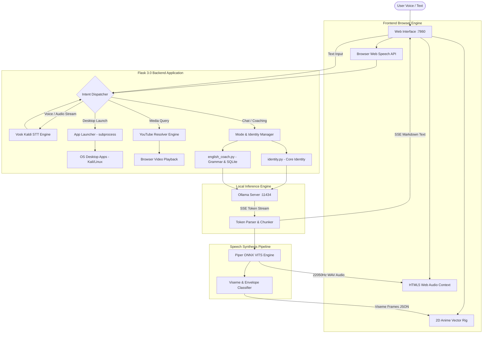
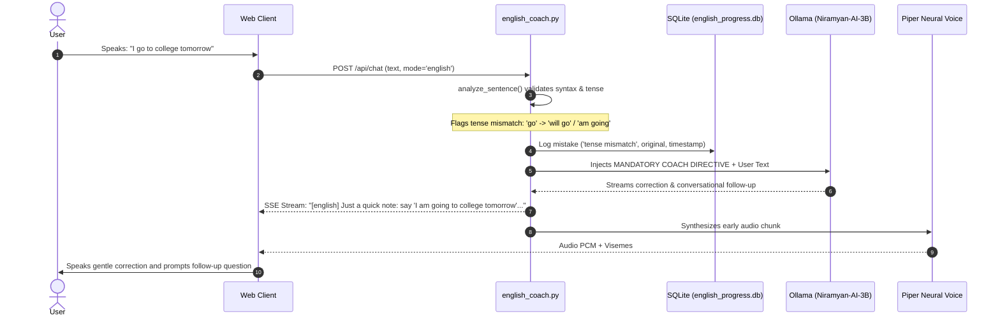
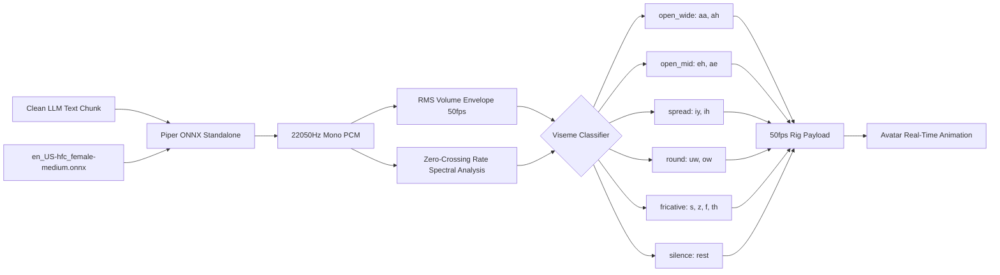

# Niramyan-AI: Privacy-First Local AI Assistant & Anime Avatar

<p align="center">
  
</p>

<p align="center">
  <b>A 100% offline, privacy-first personal AI companion, cybersecurity mentor, and English coach powered by Ollama, Piper Neural TTS, and Vosk.</b>
</p>

<p align="center">
  <a href="#-project-overview"></a>
  <a href="#-model-specifications"></a>
  <a href="https://ollama.ai"></a>
  <a href="https://github.com/rhasspy/piper"></a>
  <a href="https://alphacephei.com/vosk/"></a>
  <a href="https://flask.palletsprojects.com/"></a>
  <a href="https://www.kali.org/"></a>
  <a href="#-license--attribution"></a>
</p>

---

## 📋 Table of Contents

- [🌟 Project Overview](#-project-overview)
- [✨ Key Capabilities](#-key-capabilities)
  - [1. Local Intelligence & Real-Time Token Streaming](#1-local-intelligence--real-time-token-streaming)
  - [2. Dual-Engine Neural Voice Architecture](#2-dual-engine-neural-voice-architecture)
  - [3. Continuous Offline Speech-to-Text (STT)](#3-continuous-offline-speech-to-text-stt)
  - [4. Interactive 2D Anime Avatar & Viseme Lip-Sync](#4-interactive-2d-anime-avatar--viseme-lip-sync)
  - [5. Permanent AI Identity & Developer Alignment](#5-permanent-ai-identity--developer-alignment)
  - [6. English Learning Coach & Grammar Correction Engine](#6-english-learning-coach--grammar-correction-engine)
  - [7. Cybersecurity Mentor & Kali Linux Integration](#7-cybersecurity-mentor--kali-linux-integration)
  - [8. Desktop Automation & Instant Media Player](#8-desktop-automation--instant-media-player)
  - [9. Contact Book & WhatsApp Web Dispatcher](#9-contact-book--whatsapp-web-dispatcher)
- [🎭 Supported AI Modes](#-supported-ai-modes)
- [🏗️ System Architecture](#-system-architecture)
  - [High-Level Dataflow](#high-level-dataflow)
  - [English Coach Real-Time Correction Pipeline](#english-coach-real-time-correction-pipeline)
  - [Audio Synthesis & Viseme Generation Pipeline](#audio-synthesis--viseme-generation-pipeline)
- [🧰 Technology Stack](#-technology-stack)
- [🧠 Model Specifications](#-model-specifications)
  - [Niramyan-AI-3B (Default)](#niramyan-ai-3b-default)
  - [Niramyan-AI-7B (High-Precision Alternative)](#niramyan-ai-7b-high-precision-alternative)
- [💻 Hardware & Software Requirements](#-hardware--software-requirements)
- [🚀 Step-by-Step Installation Guide](#-step-by-step-installation-guide)
- [⚙️ Configuration](#-configuration)
  - [Voice & Avatar Settings (`voice_config.json`)](#voice--avatar-settings-voice_configjson)
  - [Contacts Management (`contacts.json`)](#contacts-management-contactsjson)
- [📖 Usage Examples](#-usage-examples)
- [📸 Screenshots & Visual Demonstrations](#-screenshots--visual-demonstrations)
- [🔒 Privacy, Security & Offline Guarantees](#-privacy-security--offline-guarantees)
- [⚠️ Limitations & Responsible AI Disclaimer](#-limitations--responsible-ai-disclaimer)
- [🗺️ Future Development Roadmap](#-future-development-roadmap)
- [👨‍💻 Developer Profile: Nithin Palegar](#-developer-profile-nithin-palegar)
- [📄 License & Attribution](#-license--attribution)

---

## 🌟 Project Overview

**Niramyan-AI** is an open-source, fully self-hosted, local personal AI assistant engineered for privacy, low latency, and multimodal voice interaction. Developed by **Nithin Palegar**, Niramyan-AI runs entirely on the user's local hardware—relying on **Ollama** for large language model inference, **Piper ONNX VITS** for neural speech synthesis, and **Vosk** for offline speech recognition.

Unlike cloud-dependent assistants that transmit microphone streams and keystrokes to remote servers, Niramyan-AI executes every operation locally:
- **Zero Cloud Telemetry**: Conversations, voice audio, and learning histories never leave your machine.
- **Ultra-Low Latency**: Server-Sent Events (SSE) streaming combined with sentence-level TTS pipelining yields first-token audio playback in under 300ms on modern CPUs.
- **Multimodal Visual Avatar**: A reactive 2D vector anime avatar synchronized with 50fps acoustic visemes, facial expressions, and natural eye-blinking cycles.
- **Real-World System Automation**: Native application launching for Kali Linux and Linux desktop environments, automated YouTube video resolution and playback, and WhatsApp Web messaging.

---

## ✨ Key Capabilities

### 1. Local Intelligence & Real-Time Token Streaming
- Powered by local GGUF models managed through Ollama (`http://127.0.0.1:11434`).
- **Server-Sent Events (SSE)** token streaming via the `/api/chat` endpoint delivers instant visual feedback to the user while LLM tokens are actively generated.
- Optimized runtime parameters (`num_ctx: 1024`, `num_predict: 45`, `num_thread: 4`) ensure rapid conversational cadence without hardware throttling.

### 2. Dual-Engine Neural Voice Architecture
- **Primary Engine (Local Piper ONNX VITS)**:
  - Default voice: `en_US-hfc_female-medium` (soft, youthful anime companion tone).
  - Secondary voice: `en_US-amy-medium` (warm, natural conversational tone).
  - Generates pristine 22,050Hz 16-bit Mono PCM audio with a Real-Time Factor (RTF) < 0.08 on CPU.
- **Fallback Engine (Web Speech API)**:
  - Zero-installation browser fallback when running on resource-constrained environments.
  - Automatically binds to high-fidelity browser voices (`Google UK English Female`, `Samantha`).
- **Phonetic Dictionary**: Pre-processes specialized cybersecurity, regional, and technical terminology (`Wireshark`, `Metasploit`, `Niramyan`, `OWASP`, `Kali`) into natural phonetic approximations before synthesis.

### 3. Continuous Offline Speech-to-Text (STT)
- **Vosk Offline Engine**: Bundled Kaldi-based lightweight English acoustic model (`vosk-model-small-en-us-0.15`) executing offline via FFmpeg 16kHz audio conversion.
- **Continuous Ambient Listening**: Hands-free ambient microphone mode with continuous listening, automatic silence detection, and speech cutoff handling.
- **Web Speech API Browser STT**: High-accuracy real-time interim results in Chromium and Chrome browsers.

### 4. Interactive 2D Anime Avatar & Viseme Lip-Sync
- Vector-rendered 2D anime avatar with expression rigging: `idle`, `talk`, `blink`, `smile`, `laugh`, `think`, and `cyber`.
- **Acoustic Viseme Extraction**: Real-time extraction of 50fps Root Mean Square (RMS) volume envelopes and Zero-Crossing Rate (ZCR) spectral classifications (`sil`, `open_wide`, `open_mid`, `spread`, `round`, `fricative`) computed from synthesized PCM waveforms.
- **Natural Eye Blinking Engine**: Asynchronous blink cycles randomized between 2.8s and 5.5s intervals with realistic 130ms eyelid transitions.

### 5. Permanent AI Identity & Developer Alignment
- Built-in permanent identity system (`identity.py`) ensuring the assistant always identifies as **Ramya**, Nithin's personal AI assistant.
- Immutably recognizes developer **Nithin Palegar**, his background as an Indian cybersecurity researcher, and his responsible disclosure recognitions across NASA, ISRO, UIDAI, NCIIPC, and CERT-In.
- Identity permanence is inherited across **all** assistant modes, preventing persona amnesia during mode transitions.

### 6. English Learning Coach & Grammar Correction Engine
- Interactive English coaching module inspired by conversational peer tutoring (`english_coach.py`).
- **Rule-Based Linguistic Error Analyzer**: Detects grammar oversights (tense mismatches such as *"I go to college tomorrow"* vs *"I will go"*, third-person singular agreements, past auxiliary forms) and injects instant pedagogical corrections.
- **SQLite Persistence**: Stores session duration, practiced sentences, logged errors, and vocabulary acquisitions in `english_progress.db`.
- **Three CEFR Skill Tiers**: Beginner (A1–A2), Intermediate (B1–B2), and Advanced (C1–C2).
- **Nine Roleplay Scenarios**: Job Interview, Restaurant, Shopping, Travel, College Life, Friendly Chat, Self Introduction, Workplace, and Free Conversation.

### 7. Cybersecurity Mentor & Kali Linux Integration
- Guided mentorship across ethical hacking, penetration testing, web application security (OWASP Top 10), and bug bounty methodologies.
- Interactive guidance on tools including Nmap, Wireshark, Burp Suite, Metasploit, and SQLMap.
- Strict defensive guardrails preventing generation of malicious exploitation payloads against unauthorized targets.

### 8. Desktop Automation & Instant Media Player
- **Native Application Launcher**: Desktop tool launcher (`APP_MAP`) supporting terminals (`gnome-terminal`, `qterminal`), browsers (`firefox`, `chromium`), editors (`code`, `mousepad`), file managers (`thunar`), and Kali security tools (`wireshark`, `burpsuite`, `msfconsole`).
- **Autonomous YouTube Video Resolution**: Intercepts queries like *"play believer"* or *"open youtube and play songs"*, scrapes the top video ID via regex-based HTTP retrieval, and automatically triggers browser playback.

### 9. Contact Book & WhatsApp Web Dispatcher
- Centralized address book (`contacts.json`) with phone number normalization (e.g., standardizing 10-digit Indian numbers to E.164 `+91`).
- Generates pre-formatted direct chat URLs (`https://web.whatsapp.com/send?phone=...&text=...`) for instant message dispatching.

---

## 🎭 Supported AI Modes

Niramyan-AI provides six specialized modes, switchable via the Web UI pills or natural voice commands:

| Mode | Voice Command | Role & Personality | Primary Functionality |
| :--- | :--- | :--- | :--- |
| **Girlfriend** (`girlfriend`) | *"Switch to Ramya mode"* | Warm, affectionate, expressive personal companion | Casual daily conversations, emotional support, companion banter |
| **English Coach** (`english`) | *"Switch to English coach"* | Patient, observant language tutor | Real-time grammar correction, vocabulary expansion, CEFR roleplays |
| **Cyber Security** (`cyber`) | *"Switch to cyber security mode"* | Sharp, technical Kali Linux mentor | Web security, bug bounty workflows, network forensics, tool usage |
| **Quiz Me** (`quiz`) | *"Switch to quiz mode"* | Interactive challenge host | Rapid-fire quizzes on cybersecurity, Linux, networking, and grammar |
| **Coding Assistant** (`coding`) | *"Switch to coding mode"* | Precise, senior software developer | Python scripting, Bash automation, debugging, algorithm design |
| **Research Mode** (`research`) | *"Switch to research mode"* | Analytical, structured technical researcher | In-depth technical synthesis, vulnerability analysis, documentation |

---

## 🏗️ System Architecture

### High-Level Dataflow



---

### English Coach Real-Time Correction Pipeline



---

### Audio Synthesis & Viseme Generation Pipeline



---

## 🧰 Technology Stack

| Layer | Component | Implementation | Role |
| :--- | :--- | :--- | :--- |
| **Inference Backend** | Large Language Model | [Ollama](https://ollama.ai) | Local LLM host exposing REST API (`:11434`) |
| **Base Model** | Niramyan-AI-3B | Qwen2 Architecture (3.1B, Q4_K_M) | Ultra-fast reasoning, instruction following, and dialogue |
| **Speech Synthesis (TTS)** | Neural Voice Engine | [Piper TTS](https://github.com/rhasspy/piper) (ONNX VITS) | Real-time, CPU-optimized feminine voice generation |
| **Speech Recognition (STT)**| Offline Voice Recognizer | [Vosk](https://alphacephei.com/vosk/) (`vosk-model-small-en-us-0.15`) | Local, offline speech-to-text without cloud API dependency |
| **Web Server** | Backend Application | [Flask 3.0](https://flask.palletsprojects.com/) + Gunicorn / Werkzeug | REST API, SSE streaming, automation dispatch, static serving |
| **Database** | Progress Persistence | SQLite3 (`english_progress.db`) | Sessions, mistake logging, vocabulary tracking, user prefs |
| **Frontend UI** | Client Interface | Vanilla HTML5 / ES6 JavaScript / CSS3 | Zero-dependency, lightweight, high-performance UI |
| **Avatar Animation** | Vector & Sprite Rig | Canvas 2D + CSS Transform Engine | 60fps lipsync, eye blinking, emotion states |
| **System Automation** | Process Management | Python `subprocess` + `shutil` | Linux desktop app launching, display detection, browser launch |

---

## 🧠 Model Specifications

### Niramyan-AI-3B (Default)

`nithinpalegar0105/Niramyan-AI-3B` is the primary conversational model for Niramyan-AI, fine-tuned for high-speed dialogue, low CPU memory footprint, and responsive chat.

```yaml
Architecture: Qwen2
Parameters: 3.09 Billion
Quantization: Q4_K_M (4-bit Medium Quantization)
Context Window: 32,768 tokens (Metadata) / 1,024 tokens (Runtime optimized)
Embedding Length: 2,048
Disk Footprint: ~1.9 GB
RAM Required: ~2.5 GB to 3.8 GB
Recommended Threads: 4 to 8
Target Hardware: Modern 4-core+ x86_64 CPU (AVX2 support)
```

To pull and verify `Niramyan-AI-3B` locally:
```bash
ollama pull nithinpalegar0105/Niramyan-AI-3B
ollama run nithinpalegar0105/Niramyan-AI-3B
```

### Niramyan-AI-7B (High-Precision Alternative)

For systems equipped with dedicated GPUs (6GB+ VRAM) or 16GB+ RAM, `Niramyan-AI-7B` offers enhanced depth for complex cybersecurity code audits, reverse-engineering analysis, and advanced English linguistics.

```yaml
Architecture: Qwen2 / Llama-3
Parameters: 7.24 Billion
Quantization: Q4_K_M / Q5_K_M
Context Window: 8,192 tokens
Disk Footprint: ~4.7 GB
RAM Required: ~8.0 GB system RAM (or 6GB VRAM)
```

To pull and run `Niramyan-AI-7B`:
```bash
ollama pull nithinpalegar0105/Niramyan-AI-7B
# To configure as active in run.sh:
export OLLAMA_MODEL="nithinpalegar0105/Niramyan-AI-7B"
```

---

## 💻 Hardware & Software Requirements

### Minimum Requirements (CPU-Only Mode)
- **Operating System**: Linux (Kali Linux 2023+, Ubuntu 22.04+, Debian 12+) or macOS.
- **CPU**: x86_64 processor with AVX2 instruction set (Intel Core i5 8th Gen+ / AMD Ryzen 3000+).
- **RAM**: 8 GB system RAM.
- **Storage**: 10 GB available SSD space.
- **Audio**: Standard microphone and speaker / headphones.

### Recommended Specifications
- **Tested Hardware Benchmark**: AMD Ryzen 5 7235HS (4 Cores / 8 Threads @ 3.2GHz), 16 GB DDR5 RAM, Kali Linux Rolling (X11 / Wayland).
- **Inference Latency**: 25–40 tokens/second on CPU.
- **TTS Synthesis Time**: 60–110ms for typical 2-sentence response.

---

## 🚀 Step-by-Step Installation Guide

Follow these instructions to set up Niramyan-AI on your Linux system.

### Step 1: Install System Dependencies
Ensure `curl`, `git`, `ffmpeg`, and `python3-venv` are installed on your system:

```bash
sudo apt update
sudo apt install -y git curl ffmpeg python3 python3-venv python3-pip
```

### Step 2: Install and Start Ollama
If Ollama is not already installed on your system, install it via the official installer:

```bash
curl -fsSL https://ollama.ai/install.sh | sh
```

Start the Ollama daemon:
```bash
ollama serve > /dev/null 2>&1 &
```

### Step 3: Clone the Repository
```bash
git clone https://github.com/nithin644/Niramyan-AI-Local-Avatar.git
cd Niramyan-AI-Local-Avatar
```

### Step 4: Install the Piper Neural Voice Engine
Execute the automated Piper installer to download the binary and voice models:

```bash
chmod +x install_piper.sh
./install_piper.sh
```

*This downloads the standalone `piper` binary and the `en_US-hfc_female-medium` ONNX voice model into `./piper/` and `./voices/`.*

### Step 5: Pull the Language Model
Pull the official Niramyan-AI model via Ollama:

```bash
ollama pull nithinpalegar0105/Niramyan-AI-3B
```

*(Optional) Create a local alias tag if required:*
```bash
ollama cp nithinpalegar0105/Niramyan-AI-3B Niramyan-AI-3B:latest
```

### Step 6: Launch Niramyan-AI
Run the automated launch script:

```bash
chmod +x run.sh
./run.sh
```

The startup script will initialize the virtual environment, verify dependencies, check Ollama connectivity, and start the web interface:

```text
==========================================================
✨ Niramyan-AI Local Avatar Assistant is ready!
   Model: nithinpalegar0105/Niramyan-AI-3B
   Voice: 🌸 Piper Neural TTS (HFC Anime Female Active)
   URL:   http://127.0.0.1:7860
==========================================================
```

Open your browser and navigate to **`http://127.0.0.1:7860`** (Chromium or Google Chrome recommended for full Web Audio / Speech API support).

---

## ⚙️ Configuration

### Voice & Avatar Settings (`voice_config.json`)

All voice synthesis, speech rate, and avatar animation parameters can be customized in `voice_config.json`:

```json
{
  "active_engine": "piper",
  "piper": {
    "enabled": true,
    "binary_path": "piper/piper",
    "selected_voice": "en_US-hfc_female-medium",
    "length_scale": 1.05,
    "noise_scale": 0.667,
    "noise_w": 0.8,
    "sentence_silence": 0.22
  },
  "web_speech": {
    "pitch": 1.28,
    "rate": 0.94,
    "volume": 1.0
  },
  "pronunciations": {
    "Niramyan": "Nee-rahm-yahn",
    "Kali": "Kah-lee",
    "Wireshark": "Wire shark",
    "SQLi": "Sequel eye",
    "Metasploit": "Meta sploit",
    "OWASP": "Oh-wasp",
    "Burp Suite": "Burp Sweet"
  },
  "animation": {
    "viseme_fps": 50,
    "blink_min_interval_sec": 2.8,
    "blink_max_interval_sec": 5.5,
    "blink_duration_ms": 130
  }
}
```

### Contacts Management (`contacts.json`)

Store phone numbers for automated WhatsApp dispatch:

```json
{
  "nithin": "919876543210",
  "alex": "14155552671"
}
```

---

## 📖 Usage Examples

### 1. Hands-Free Conversational Voice
- Click the **🎙️ Mic** button or enable **Hands-Free Mode** at the top right.
- Speak naturally:
  > *"Hey Ramya, who created you?"*
- Ramya immediately identifies herself and her developer, **Nithin Palegar**, citing his cybersecurity research background.

### 2. English Coach Grammar Check
- Switch to **English Coach** mode.
- Speak or type:
  > *"I go to college tomorrow."*
- Ramya responds:
  > *"[english] That's great! Just a quick correction: say 'I am going to college tomorrow' or 'I will go to college tomorrow' because it's happening in the future. What are you planning to study at college, Nithin?"*

### 3. Desktop Application Launching
- Say:
  > *"Open Wireshark"* or *"Launch terminal"*
- Niramyan-AI executes the system binary and responds:
  > *"Opening Wireshark for you right now."*

### 4. Automated YouTube Song Playback
- Say:
  > *"Open YouTube and play believer song"*
- The assistant resolves the top video URL and opens it directly in your browser.

---

## 📸 Screenshots & Visual Demonstrations

### 1. Main Conversational Interface & 2D Avatar

<!-- Placeholder for Main Conversational Interface Screenshot -->

*Figure 1: Niramyan-AI running locally with active 2D anime avatar, mode chips, and ambient microphone controls.*

---

### 2. English Learning Coach & Grammar Analysis

<!-- Placeholder for English Coach Mode Screenshot -->

*Figure 2: Real-time grammatical analysis and roleplay scenario selector in English Coach mode.*

---

### 3. Voice & Avatar Configuration Modal

<!-- Placeholder for Settings Modal Screenshot -->

*Figure 3: Runtime adjustments for Piper TTS models, length scale, phonetics, and viseme FPS.*

---

### 4. Video Demonstration

<!-- Placeholder for Video Walkthrough Link -->
[](https://github.com/nithin644/Niramyan-AI-Local-Avatar)
*Video demonstration showing zero-latency voice interaction, English coaching, and Kali Linux tool automation.*

---

## 🔒 Privacy, Security & Offline Guarantees

- **100% On-Premise Execution**: No speech data or prompts are transmitted across the internet.
- **Air-Gapped Operation**: Once models are pulled, Niramyan-AI functions fully without an active internet connection.
- **Zero Third-Party Analytics**: No telemetry, tracking pixels, or remote logging.
- **Secure System Execution**: Application launching is strictly bounded to pre-configured binaries in `APP_MAP` to prevent arbitrary command execution.

---

## ⚠️ Limitations & Responsible AI Disclaimer

- **Hardware Dependency**: Token generation speed and TTS latency are directly bound to your CPU/GPU hardware.
- **Cybersecurity Defensive Scope**: Niramyan-AI is designed for educational, research, and defensive auditing purposes only. It will not generate weaponized exploit code or assist in unauthorized attacks.
- **Linguistic Heuristics**: The rule-based English error analyzer provides conversational guidance and should not be treated as a formal certification grading system.

---

## 🗺️ Future Development Roadmap

- [ ] **Full 3D / Live2D Rigging**: Transition from 2D vector sprite sheets to full Live2D WebGL mesh rendering.
- [ ] **Local Retrieval-Augmented Generation (RAG)**: Offline document ingestion for personal cybersecurity notes and English textbooks using `chromadb`.
- [ ] **Hardware Wake-Word Engine**: Integration of openWakeWord for true hands-off voice activation (*"Hey Ramya"*).
- [ ] **Multi-Speaker Diarization**: Recognition of multiple local speakers during group study sessions.

---

## 👨‍💻 Developer Profile: Nithin Palegar

<p align="left">
  <b>Nithin Palegar</b> is an Indian cybersecurity researcher, ethical hacker, and B.Tech Computer Science and Engineering student.
</p>

- **GitHub**: [https://github.com/nithin644](https://github.com/nithin644)
- **Portfolio**: [https://nithin644.github.io](https://nithin644.github.io)
- **Core Research Areas**:
  - Web Application Penetration Testing & Bug Bounty Hunting
  - Malware Analysis & Reverse Engineering
  - Digital Forensics & Vulnerability Research
  - Web Security & WAF Bypass Research
  - LLM Security & AI Guardrail Hardening
- **Responsible Disclosure & Public Recognition**:
  - Public Hall of Fame recognition and appreciation for responsible vulnerability disclosures involving organizations including:
    - **NASA** (National Aeronautics and Space Administration)
    - **ISRO** (Indian Space Research Organisation)
    - **UIDAI** (Unique Identification Authority of India)
    - **NCIIPC** (National Critical Information Infrastructure Protection Centre)
    - **CERT-In** (Indian Computer Emergency Response Team)

---

## 📄 License & Attribution

This project is released under the **[MIT License](LICENSE)**.

### Upstream Open-Source Projects & Credits:
- **[Ollama](https://ollama.ai)**: Local LLM runtime and model server.
- **[Piper](https://github.com/rhasspy/piper)**: High-performance local neural text-to-speech system by Rhasspy.
- **[Vosk](https://alphacephei.com/vosk/)**: Offline speech recognition toolkit by Alpha Cephei.
- **[Qwen Team](https://github.com/QwenLM/Qwen2)**: Base open weights architecture powering the `Niramyan-AI-3B` model.

